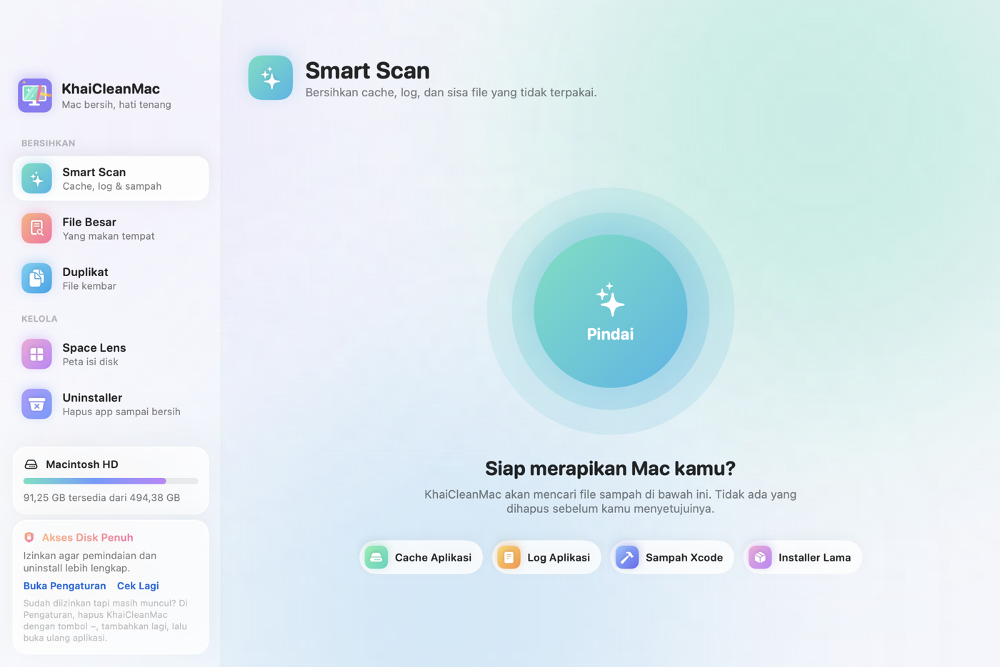
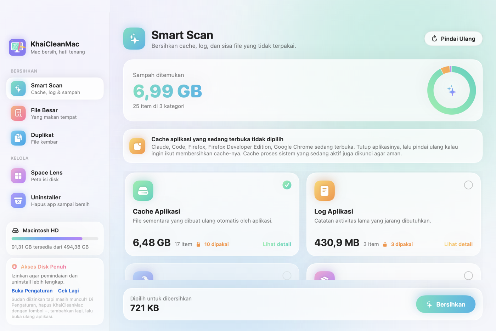
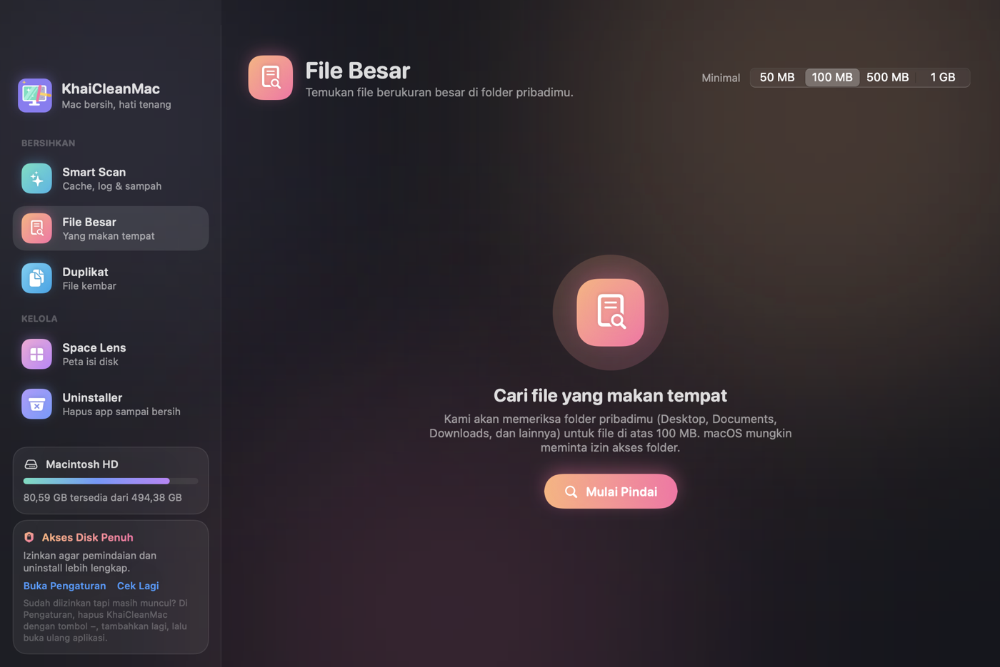
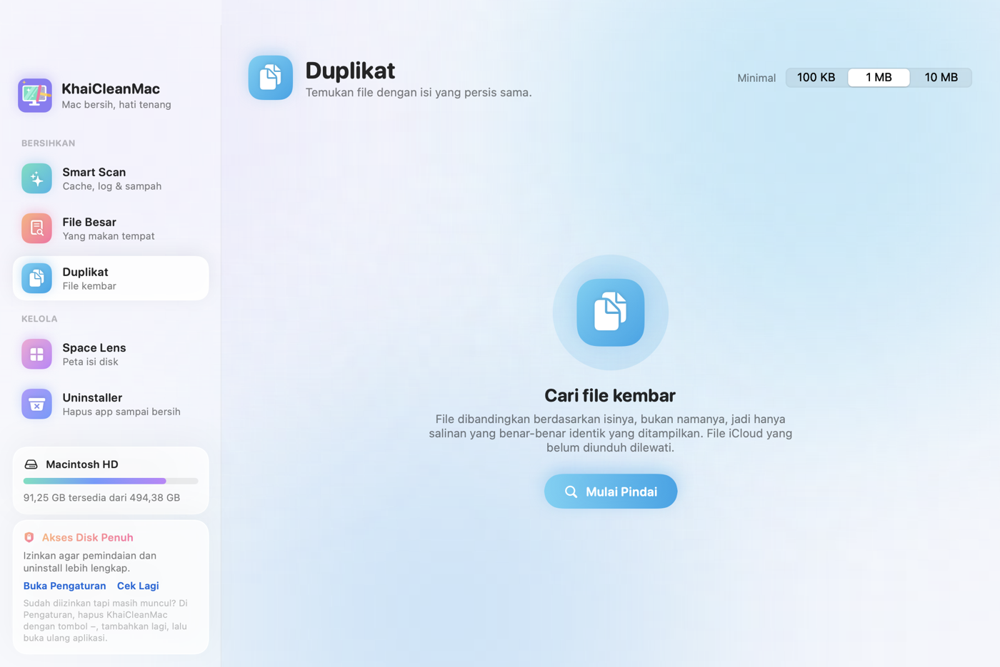
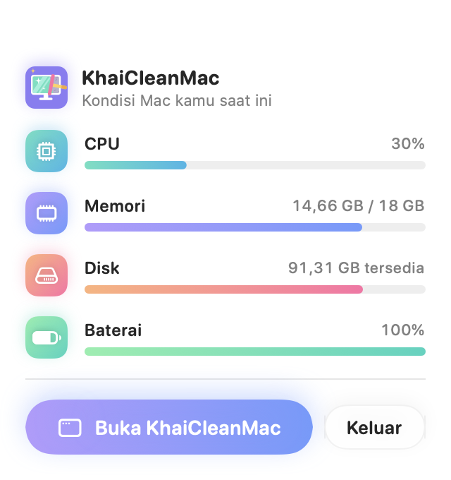

<p align="center">
  
</p>

<h1 align="center">KhaiCleanMac</h1>

<p align="center">
  A friendly, source-available Mac cleaner with a soft pastel look.<br>
  Native Swift + SwiftUI · macOS 15+ · PolyForm Noncommercial license
</p>

<p align="center">
  <a href="LICENSE"></a>
  
  
</p>

<p align="center"><a href="README.id.md">Baca dalam Bahasa Indonesia</a></p>

<p align="center">
  
</p>

## Features

| Module | What it does |
|---|---|
| **Smart Scan** | Finds app caches (`~/Library/Caches`), logs (`~/Library/Logs`), Xcode leftovers (DerivedData, Device Support, simulator caches) and old `.dmg`/`.pkg` installers in Downloads |
| **Large Files** | Finds files above 50 MB, 100 MB, 500 MB or 1 GB in your home folder, with type filters and sorting |
| **Duplicates** | Finds files with byte-identical content and keeps the oldest copy by default |
| **Space Lens** | Shows a treemap of any folder (Home by default). Double-click to drill in, use the breadcrumb to go back |
| **Uninstaller** | Removes apps from `/Applications` and `~/Applications` together with the files they leave behind (Application Support, Caches, Preferences, Containers, Group Containers, LaunchAgents and more) |
| **Menu bar** | Shows live CPU usage in the menu bar, plus a panel with CPU, memory, disk and battery |
| **Settings** | Switch the language (Bahasa Indonesia or English) and the appearance (Match System, Light or Dark). Open it with ⌘, or from the bottom of the sidebar |

See [CHANGELOG.md](CHANGELOG.md) for what changed in each version. The current version is shown at the bottom of the sidebar and in Settings → About.

<p align="center">
  
  
</p>
<p align="center">
  
  
</p>

## Safety first

- **Nothing is deleted permanently.** Every item goes to the Trash, so you can put it back until you empty the Trash.
- **Nothing is removed without your approval.** Each module shows exactly what it found and asks you to confirm first.
- **Open apps are protected.** Smart Scan locks the caches and logs of apps that are currently running and checks again right before cleaning.
- **The Uninstaller skips Apple's built-in apps** and refuses to remove an app while it is running.
- **Duplicates are handled carefully:**
  - Symlinks and hard links never count as copies.
  - Project and bundle folders (`node_modules`, `Pods`, `build`, `vendor`, `.app`, `.framework`, …) are skipped.
  - iCloud files that are not downloaded are never read.
  - At least one copy in every group is always kept.

### How duplicates are detected

Files are compared by content, never by name, in three passes:

1. **Size.** Only files that share the same size can be duplicates.
2. **First 64 KB.** A SHA-256 of the first 64 KB rules out most of the remaining files quickly.
3. **Full content.** A SHA-256 of the whole file confirms the match.

Similar photos and the same song in different formats are not detected. On APFS, Finder copies can be clones that share disk blocks, so removing one may free less space than its size suggests.

## Requirements

- macOS 15 Sequoia or later
- Xcode 16 or later (Swift 6 toolchain)

## Build and run

```bash
git clone https://github.com/rizkyraf8/KhaiCleanMac.git
cd KhaiCleanMac
./scripts/build-app.sh
open build/KhaiCleanMac.app
```

`build-app.sh` compiles a release build, generates the app icon and puts together `build/KhaiCleanMac.app`. While developing you can also use `swift run`, or open `Package.swift` in Xcode.

If you use [swiftly](https://github.com/swiftlang/swiftly), the `.swift-version` file makes it use Xcode's Swift toolchain in this folder.

### Full Disk Access

Some folders can only be scanned with Full Disk Access. You can grant it in **System Settings → Privacy & Security → Full Disk Access**, and the button in the sidebar opens that page for you.

Local builds are ad-hoc signed. Because of that, macOS forgets the permission every time you rebuild. To keep the permission across rebuilds, do one of the following:
- Create a code-signing certificate named `KhaiCleanMac Local` (Keychain Access → Certificate Assistant → Create a Certificate → type *Code Signing*).
- Set `KHAI_SIGN_IDENTITY` to a signing identity you already have.

`build-app.sh` signs with that certificate or identity when it finds one.

### Debug snapshots

Debug builds can render every screen to PNG without opening a window:

```bash
swift build && .build/debug/KhaiCleanMac --snapshot ./snapshots [--dark] [--results]
```

`--results` also runs the scans, which only read files, so you can see the results screens. Those screens show real file names from your home folder, so review them before sharing.

## Project structure

```
Sources/KhaiCleanMac/
  App/         entry point, settings (language, appearance), debug snapshots
  Design/      theme (palette, background, cards), components, logo artwork
  Models/      modules, junk categories, file kinds, scan results
  Services/    scanners (junk, large files, duplicates, apps, disk space),
               running-app matching, Trash, permissions, system monitor
  ViewModels/  @Observable state for each module
  Views/       sidebar and one view per module, menu bar panel
scripts/       build-app.sh, make-icon/
Resources/     Info.plist, AppIcon.icns, logo
docs/          README images
```

The logo is drawn in code in `Design/LogoArtwork.swift`. The app icon and the sidebar logo both come from that file. `build-app.sh` regenerates `AppIcon.icns` whenever that file changes.

## Roadmap

- Keep running in the menu bar after the window closes, and launch at login
- Login Items and LaunchAgents manager
- Empty the Trash and clean system caches through a privileged helper
- Developer ID signing and notarization for a downloadable DMG

## Contributing

Issues and pull requests are welcome. Please keep the safety rules above intact. Anything that removes files has to go to the Trash and has to be confirmed by the user.

## License

[PolyForm Noncommercial 1.0.0](LICENSE) © 2026 Rizky Aditya Fahreza

KhaiCleanMac is an independent project. It is not affiliated with or endorsed by MacPaw or CleanMyMac.
